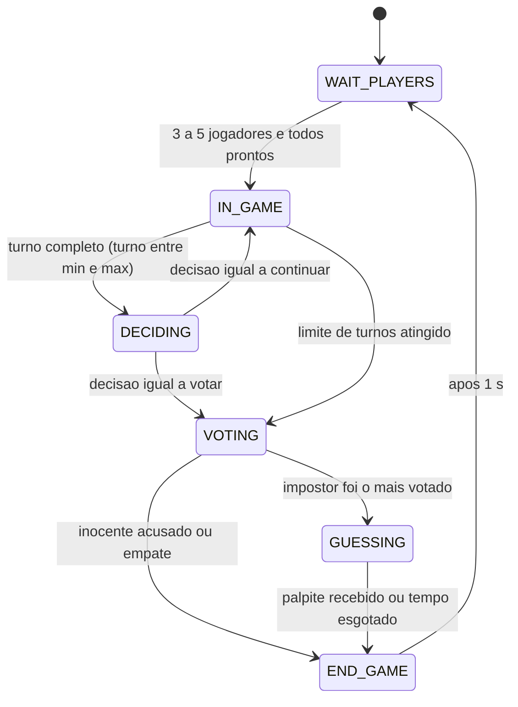
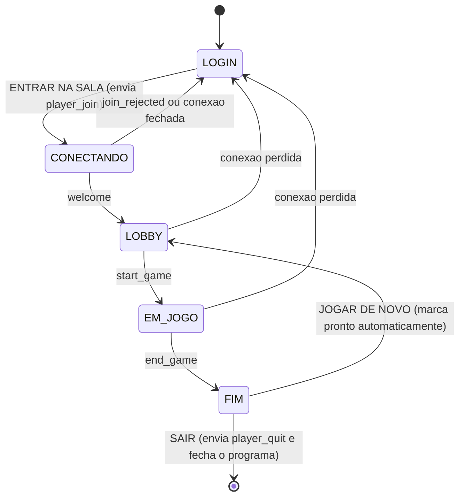
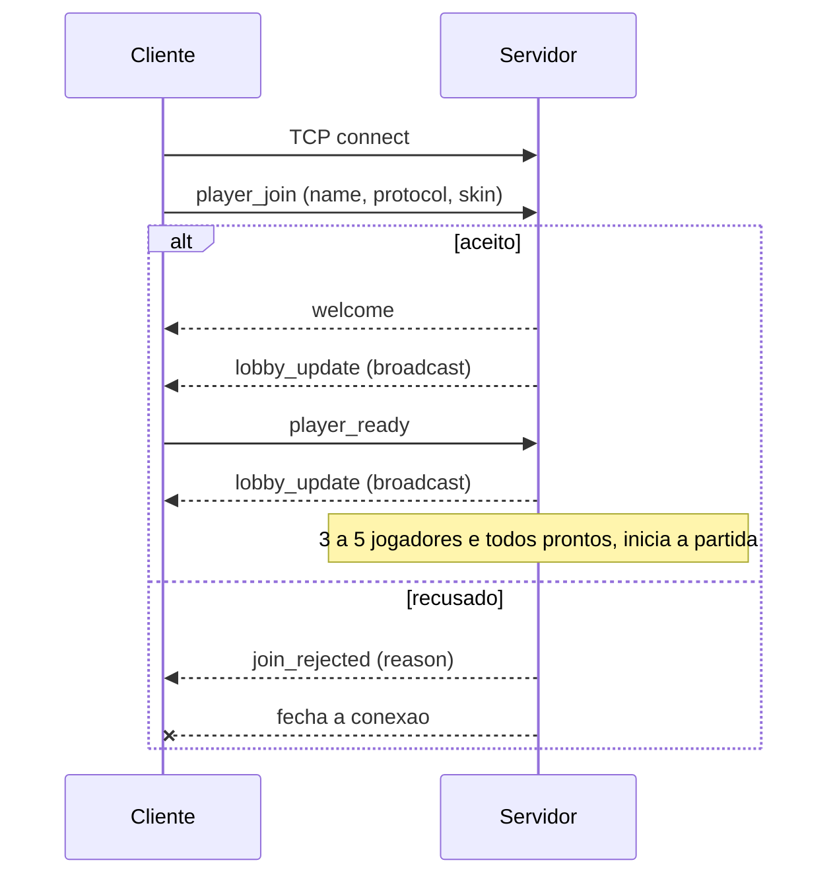
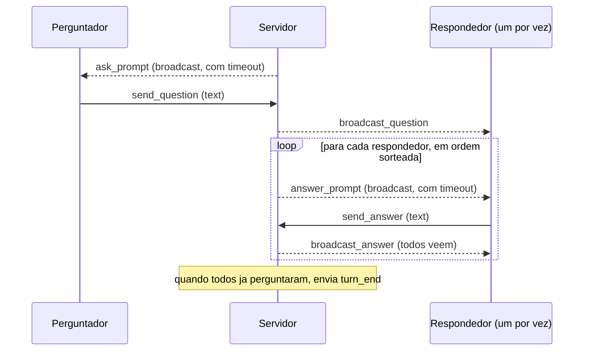
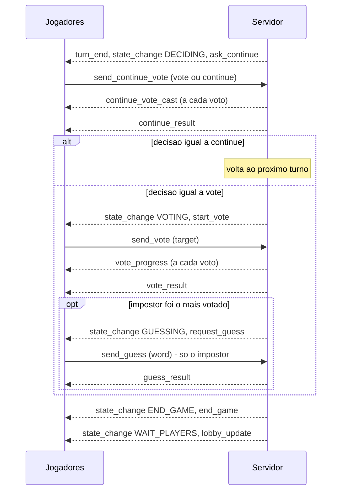

# 🕵️ IMPOSTOR — Jogo de dedução multiplayer (Cliente-Servidor / TCP)

Aplicação distribuída no modelo **cliente-servidor** em que de 3 a 5 jogadores, cada um em seu próprio computador, jogam uma partida de dedução social pela rede. A comunicação é feita por **sockets TCP** usando um **protocolo de camada de aplicação próprio** (`IMPOSTOR/1.0`), documentado neste arquivo.

> Trabalho da disciplina de Redes de Computadores — UESC.

| | |
|---|---|
| **Linguagem** | Python 3 |
| **Transporte** | TCP (porta padrão `5000`) |
| **Servidor** | `server.py` (somente biblioteca padrão) |
| **Cliente** | `client.py` (interface gráfica Tkinter + Pillow) |
| **Equipe** | André Nascimento Pardinho, Cauan Mendonça Valadão, Guilherme Afonso Bongestab, Jéssica Meira Costa e Pedro Henrique Soares Magalhães |

---

## Sumário

1. [Propósito da aplicação](#1-propósito-da-aplicação)
2. [Como o jogo funciona](#2-como-o-jogo-funciona)
3. [Arquitetura](#3-arquitetura)
4. [Por que TCP?](#4-por-que-tcp)
5. [Requisitos mínimos](#5-requisitos-mínimos)
6. [Instalação e execução](#6-instalação-e-execução)
7. [Protocolo de camada de aplicação — IMPOSTOR/1.0](#7-protocolo-de-camada-de-aplicação--impostor10)
8. [Estrutura do repositório](#8-estrutura-do-repositório)
9. [Originalidade e diferenciais](#9-originalidade-e-diferenciais)
10. [Limitações conhecidas](#10-limitações-conhecidas)

---

## 1. Propósito da aplicação

O objetivo é demonstrar, de forma prática, um sistema distribuído em que **vários clientes mantêm conexões simultâneas e de longa duração com um servidor central** que aplica as regras, controla de quem é a vez e retransmite eventos em tempo real a todos.

O jogo escolhido, **Impostor**, é um bom caso de uso porque exige exatamente o que um protocolo de aplicação precisa resolver:

- **Informação assimétrica:** todos recebem o *tema*, mas só os jogadores comuns recebem a *palavra secreta*. O servidor envia mensagens **individuais** (`role_assign`) e mensagens **para toda a sala** (broadcast).
- **Sincronização de turnos:** só quem tem a vez pode agir; o servidor valida e rejeita ações fora de hora.
- **Eventos em tempo real:** respostas, votos parciais e resultados aparecem para todos na hora.
- **Máquina de estados** bem definida (lobby → turnos → decisão → votação → palpite → fim).
- **Tolerância a falhas:** timeouts por ação e tratamento de desconexão no meio da partida.

---

## 2. Como o jogo funciona

**Objetivo.** Todos os jogadores recebem um **tema** (ex.: *Comidas*, *Lugares*, *Vilões*). Os jogadores normais também recebem a **palavra secreta**. Um jogador, sorteado pelo servidor, é o **Impostor**: ele só conhece o tema e precisa se disfarçar.

**Um turno**
1. Um jogador por vez faz **uma pergunta** sobre a palavra para todos.
2. Os demais respondem **um de cada vez** (ordem sorteada pelo servidor). As respostas são públicas — quem responde por último já viu as anteriores.
3. Quando todos já perguntaram, o turno termina.

**Fim de cada turno: Continuar ou Votação?** Todos votam, ao vivo e publicamente. É necessária a **maioria absoluta** (mais da metade dos jogadores presentes) para ir à votação; empate ou omissão significa *continuar*. Ao atingir o limite de turnos (padrão: 5), a votação é obrigatória.

**Votação do Impostor.** Cada jogador vota em quem acha que é o impostor (ninguém vota em si mesmo). Os votos só são revelados na apuração.

**Resultado**

| Situação | Resultado |
|---|---|
| O mais votado **não** é o impostor | **Impostor vence** |
| Empate na votação (ou nenhum voto) | **Impostor vence** |
| O mais votado **é** o impostor e ele **acerta** a palavra | **Empate** |
| O mais votado **é** o impostor e ele **erra** a palavra | **Jogadores vencem** |

O palpite ignora acentos, maiúsculas e espaços extras (`"Feijão"` = `" feijao "`). Há limite de tempo para cada ação (padrão: 60 s para perguntar/responder/palpitar e 45 s para votar); se o jogador não agir, o passo é pulado. Ao final, a sala volta ao lobby para uma nova partida.

O servidor possui **10 temas** (comidas, animais e pets, profissões, lugares, objetos, veículos, vilões e antagonistas, superpoderes, monstros e criaturas, memes da internet) com **mais de 280 palavras** no total.

---

## 3. Arquitetura

```
 ┌──────────────┐                                   ┌────────────────────────────────────┐
 │  client.py   │  TCP  (JSON por linha)            │              server.py             │
 │  Jogador 1   │◄─────────────────────────────────►│  thread principal: accept()        │
 └──────────────┘                                   │                                    │
 ┌──────────────┐                                   │  thread por cliente (handle_client)│
 │  client.py   │◄─────────────────────────────────►│   └─ valida msgs e põe em fila     │
 │  Jogador 2   │                                   │                                    │
 └──────────────┘                                   │  thread da partida (_run_game)     │
        ...                                         │   └─ "árbitro": máquina de estados │
 ┌──────────────┐                                   │      consome a fila de eventos     │
 │  client.py   │◄─────────────────────────────────►│                                    │
 │  Jogador 5   │                                   └────────────────────────────────────┘
 └──────────────┘
```

### Servidor (`server.py`)

- **Thread principal** — `accept()` em loop; cria uma thread para cada conexão.
- **Uma thread por cliente** (`handle_client`) — faz o *handshake*, lê mensagens (uma linha JSON por vez), valida o formato e deposita os eventos de jogo numa `queue.Queue`.
- **Uma thread de partida** (`_run_game`) — é o **árbitro**. É a única que executa a lógica do jogo e decide de quem é a vez, consumindo a fila de eventos. Assim, não há disputa entre threads pela lógica do jogo.
- **Estado compartilhado** (lista de jogadores e estado atual) protegido por `RLock`; o envio a cada jogador é protegido por um `Lock` próprio, para que linhas JSON de threads diferentes não se misturem no fluxo TCP.
- **O servidor é a fonte da verdade:** sorteia tema, palavra, impostor e ordens; valida toda ação; o cliente apenas exibe e envia intenções.

### Cliente (`client.py`)

- Interface gráfica em **Tkinter + Pillow**: tela de login (nome, servidor, porta e escolha de *skin*), sala com avatares em círculo, balões de pergunta/resposta/voto, barra de ações, janela de regras e histórico da partida.
- Uma **thread leitora** (`reader`) recebe as linhas do socket e as coloca numa fila (`inbox`); o laço da interface (`pump`, a cada 40 ms) consome a fila e despacha para os métodos `on_<tipo-da-mensagem>`. Isso mantém a interface fluida sem acessar widgets a partir de outra thread.
- Na tela de login, uma consulta rápida e periódica (`skins_query`, a cada ~2,5 s) mostra em tempo real quais *skins* já estão em uso.

**Principais componentes do `client.py`**

| Componente | Papel |
|---|---|
| `App` (`tk.Tk`) | Janela principal: guarda o estado local (`reset_state`), trata as mensagens do servidor (métodos `on_<type>`) e envia as ações do jogador (`send`) |
| `reader` | Thread leitora: lê uma linha JSON por vez do socket e a deposita em `inbox`; ao fim da conexão deposita `__closed__` |
| `pump` / `_pump_once` | Laço da interface (40 ms): consome `inbox`, chama `handle`, redesenha a sala e atualiza o cronômetro |
| `set_pending(kind, timeout)` | Marca que o jogador precisa agir (`ask`, `answer`, `continue`, `vote`, `guess`) e inicia a contagem regressiva |
| `submit_text`, `choose_continue`, `cast_vote` | Convertem a ação do jogador na mensagem `send_question` / `send_answer` / `send_guess`, `send_continue_vote` ou `send_vote` |
| `render_bar` / `sync_bar` | Montam a barra de ações de acordo com o que o servidor está pedindo |
| `redraw`, `draw_*`, `SCanvas` | Desenho da sala em coordenadas de projeto 1000×620, com escala automática |
| `load_icons`, `load_background` | Carregam as *skins* (`Images/`) e o fundo (`background/`) |

O cliente **não decide nada sobre as regras**: apenas exibe o que o servidor anuncia e envia a intenção do jogador. Se o servidor rejeitar uma ação, ele responde com `error` (ver 7.6) e o cliente reabre a entrada quando o erro é `INVALID_INPUT`.

---

## 4. Por que TCP?

Escolhemos o **TCP** em vez do UDP pelos seguintes motivos:

| Necessidade do jogo | Como o TCP atende |
|---|---|
| **Nenhuma mensagem pode ser perdida.** Uma pergunta, resposta, voto ou palpite perdido travaria a partida ou alteraria o resultado. | Entrega confiável com retransmissão automática. |
| **A ordem importa.** `ask_prompt` → `broadcast_question` → `answer_prompt` → ... precisam chegar na sequência em que foram enviados. | Entrega **ordenada** dos bytes. |
| **O servidor precisa saber quem está conectado.** Entrada/saída de jogadores, desconexão do impostor e "sala cheia" dependem de conexões. | Protocolo **orientado a conexão**; fechamento/queda são detectados (EOF, `OSError`, `SO_KEEPALIVE`). |
| **Tráfego leve e interativo, sem exigência de tempo real estrito.** O jogo é por turnos; mensagens são pequenas e esperadas em segundos. | A latência extra do TCP é irrelevante; `TCP_NODELAY` evita o atraso do algoritmo de Nagle. |

Com UDP teríamos de reimplementar na aplicação confirmações, retransmissão, ordenação e controle de sessão — complexidade sem nenhum ganho para um jogo de turnos.

Como o TCP é um **fluxo de bytes sem fronteiras de mensagem**, o protocolo define seu próprio *framing*: **uma mensagem JSON por linha, terminada em `\n`** (veja a seção 7.1).

---

## 5. Requisitos mínimos

**Servidor**
- Python **3.8+** (somente biblioteca padrão — nenhuma instalação adicional).
- Porta **TCP 5000** (ou outra escolhida) liberada no firewall.

**Cliente (cada jogador)**
- Python **3.8+** com **Tkinter** (no Linux: `sudo apt install python3-tk`).
- **Pillow**: `pip install pillow`.
- Resolução de tela de pelo menos ~520×420 (a interface se adapta ao tamanho da janela).
- Pasta `Images/` com **pelo menos 5 imagens** (uma por jogador possível; sem imagens o cliente usa uma skin "Padrão" única) (`.png`, `.jpg`, `.jpeg`, `.webp` ou `.bmp`) — o **nome do arquivo é o nome da skin** e duas pessoas não podem usar a mesma skin.
- Pasta `background/` com uma imagem de fundo da sala (usa a primeira encontrada; se não houver, usa cor lisa).

**Rede e jogadores**
- Conectividade TCP entre cada cliente e o servidor (mesma máquina, rede local ou Internet com porta aberta).
- **De 3 a 5 jogadores** (3 clientes conectados e "prontos" já iniciam a partida). Para testar sozinho, abra 3 instâncias de `client.py` na mesma máquina.

---

## 6. Instalação e execução

```bash
git clone <URL-DO-REPOSITORIO>
cd <pasta-do-projeto>
pip install pillow
```

### 6.1 Servidor

```bash
python3 server.py                       # escuta em 0.0.0.0:5000
python3 server.py --port 6000 --max-turns 3 --turn-timeout 90
```

| Parâmetro | Padrão | Descrição |
|---|---|---|
| `--host` | `0.0.0.0` | Interface de escuta |
| `--port` | `5000` | Porta TCP |
| `--min-turns` | `1` | Turnos completos antes da 1ª decisão "Continuar × Votação" |
| `--max-turns` | `5` | Ao atingir este número de turnos, a votação é obrigatória |
| `--turn-timeout` | `60` | Segundos para perguntar, responder ou palpitar |
| `--vote-timeout` | `45` | Segundos para votar (Continuar × Votação e votação do impostor) |

### 6.2 Cliente

```bash
python3 client.py                                   # conecta em 127.0.0.1:5000
python3 client.py --host 192.168.0.10 --port 5000 --name Ana
```

1. Digite o **nome** (1 a 15 letras, números, `_` ou `-`), confirme o **servidor/porta** e escolha uma **skin**.
2. Clique em **ENTRAR NA SALA**.
3. No lobby, clique em **ESTOU PRONTO** (ou pressione `Enter`). A partida começa quando houver **3 a 5 jogadores e todos estiverem prontos**.

Atalhos: `F11` tela cheia · `Esc` sai da tela cheia · `Enter` = "Estou pronto" no lobby.
Durante a partida: botão **"Ver a palavra (segure)"** mostra de novo a palavra (só para você) e **"Histórico"** lista as perguntas e respostas.

### 6.3 Jogando em máquinas diferentes

Quem hospeda roda `server.py` e informa seu IP (ex.: `ip addr` / `ipconfig`); os demais colocam esse IP no campo **Servidor**.

### 6.4 Testando o protocolo sem a interface gráfica

Como o protocolo é texto (JSON por linha), o servidor pode ser testado com `nc`/`telnet`, sem `client.py`. O campo `skin` é opcional:

```bash
nc 127.0.0.1 5000
{"type":"player_join","data":{"name":"Teste","protocol":"IMPOSTOR/1.0"}}
{"type":"player_ready","data":{}}
{"type":"ping","data":{"t":1}}
```

Mensagens inválidas retornam `error` (ex.: `BAD_MESSAGE`) e uma versão de protocolo errada retorna `join_rejected`. O log do servidor (`INFO`) mostra conexões, mudanças de estado e o resultado de cada partida.

---

## 7. Protocolo de camada de aplicação — IMPOSTOR/1.0

### 7.1 Visão geral

| Item | Definição |
|---|---|
| **Transporte** | TCP, uma conexão por jogador, mantida aberta durante toda a sessão |
| **Modelo** | Cliente-servidor. O cliente envia *intenções*; o servidor valida, decide e retransmite *eventos* |
| **Codificação** | JSON em **UTF-8** |
| **Framing** | **Uma mensagem por linha**, delimitada por `\n` |
| **Formato** | `{"type": "<evento>", "data": { ... }}` — `type` é obrigatório (string); `data` é um objeto (pode ser omitido, equivale a `{}`) |
| **Versão** | `IMPOSTOR/1.0`, declarada no `player_join`; versão diferente é recusada |
| **Tamanho máximo** | 4096 caracteres por mensagem (excedeu → o servidor encerra a conexão) |
| **Limites de campo** | Nome: `^[\w\-]{1,15}$` · texto de pergunta/resposta/palpite: até 200 caracteres (excesso é truncado) · skin: até 40 caracteres |
| **Sala** | Uma única sala por servidor: mínimo **3**, máximo **5** jogadores |
| **Papéis** | `CIVILIAN` (conhece a palavra) e `IMPOSTOR` (só conhece o tema) |

**Tipos de entrega**
- **Unicast** — só para um jogador (`welcome`, `join_rejected`, `role_assign`, `error`, `pong`, `skins_taken`).
- **Broadcast** — para todos da sala (todos os demais eventos).

**Privacidade das informações.** A palavra só é enviada aos civis (`role_assign` individual; o impostor recebe `word: null`). Os votos de "Votação do impostor" **não** são revelados durante a coleta (`vote_progress` só informa contagem) — apenas em `vote_result`. Já os votos "Continuar × Votação" são **públicos e ao vivo** (`continue_vote_cast`).

### 7.2 Máquina de estados do servidor



| Estado | Significado | Eventos do cliente aceitos |
|---|---|---|
| `WAIT_PLAYERS` | Lobby: aguardando jogadores e "pronto" | `player_ready`, `player_quit`, `ping` |
| `IN_GAME` | Turno: perguntas e respostas, uma pessoa por vez | `send_question` (só o perguntador da vez), `send_answer` (só o respondedor da vez) |
| `DECIDING` | Fim de cada turno: *Continuar* ou *Votação* | `send_continue_vote` (todos) |
| `VOTING` | Votação do impostor | `send_vote` (todos) |
| `GUESSING` | Impostor descoberto tenta adivinhar a palavra | `send_guess` (só o impostor) |
| `END_GAME` | Resultado final | — (sala volta ao lobby em seguida) |

**Transições do servidor**

| De → Para | Gatilho | Mensagens emitidas |
|---|---|---|
| `WAIT_PLAYERS` → `IN_GAME` | 3 a 5 jogadores, todos com `player_ready` | `state_change`, `start_game`, `role_assign` (um por jogador), `turn_start` |
| `IN_GAME` → `DECIDING` | Todos já perguntaram e `turno >= min-turns` e `turno < max-turns` | `turn_end`, `state_change`, `ask_continue` |
| `DECIDING` → `IN_GAME` | Maioria absoluta **não** pediu votação | `continue_result` (`decision: continue`), `state_change`, `turn_start` |
| `DECIDING` → `VOTING` | Mais da metade dos presentes votou `vote` | `continue_result` (`decision: vote`), `state_change`, `start_vote` |
| `IN_GAME` → `VOTING` | `turno >= max-turns` | `turn_end`, `info` (limite atingido), `state_change`, `start_vote` |
| `VOTING` → `GUESSING` | Mais votado, isolado, é o Impostor | `vote_result`, `state_change`, `request_guess` |
| `VOTING` → `END_GAME` | Inocente acusado, empate ou nenhum voto | `vote_result`, `state_change`, `end_game` |
| `GUESSING` → `END_GAME` | Palpite recebido ou tempo esgotado | `guess_result`, `state_change`, `end_game` |
| `END_GAME` → `WAIT_PLAYERS` | 1 s depois do fim | `state_change`, `lobby_update` |

Em qualquer estado de jogo, `player_quit`/queda de conexão e `ping` são tratados. Se **o impostor se desconecta** ou **restam menos de 3 jogadores**, a partida é **abortada** (`end_game` com `result: "ABORTED"`) e a sala volta ao lobby.

Cada mudança de estado é anunciada a todos por `state_change`.

### 7.3 Estados do cliente



Dentro de `EM_JOGO` o cliente fica "pendente" de uma ação do jogador quando recebe um *prompt* do servidor: `ask` (pergunta), `answer` (resposta), `continue` (Continuar/Votação), `vote` (voto) ou `guess` (palpite), cada uma com contagem regressiva do `timeout` informado.

### 7.4 Catálogo de mensagens

#### Cliente → Servidor

| `type` | `data` | Quando | Validação / efeito |
|---|---|---|---|
| `skins_query` | `{}` | Só como 1ª mensagem (consulta da tela de login) | Servidor responde `skins_taken` e **fecha** a conexão, sem entrar na sala |
| `player_join` | `{name, protocol, skin?}` | 1ª mensagem obrigatória (handshake) | Versão, nome, sala, estado e skin são checados (ver 7.6) |
| `player_ready` | `{}` | No lobby | Marca o jogador como pronto; pode iniciar a partida |
| `player_quit` | `{}` | A qualquer momento | Servidor encerra a conexão e remove o jogador |
| `ping` | `{t}` | A qualquer momento | Servidor responde `pong` com o mesmo `t` |
| `send_question` | `{text}` | Após `ask_prompt` com `asker` = você | Texto não vazio (≤ 200) |
| `send_answer` | `{text}` | Após `answer_prompt` com `responder` = você | Texto não vazio (≤ 200) |
| `send_continue_vote` | `{choice}` | Após `ask_continue` | `choice` ∈ {`"vote"`, `"continue"`} |
| `send_vote` | `{target}` | Após `start_vote` | `target` = jogador existente, diferente de si mesmo (sem diferenciar maiúsculas) |
| `send_guess` | `{word}` | Após `request_guess` (só o impostor) | Texto não vazio (≤ 200) |

#### Servidor → Cliente

| `type` | Entrega | `data` | Descrição |
|---|---|---|---|
| `skins_taken` | unicast | `{skins: [..]}` | Skins em uso (resposta ao `skins_query`) |
| `welcome` | unicast | `{name, protocol, min_players, max_players, skin}` | Entrada aceita |
| `join_rejected` | unicast | `{reason}` | Entrada recusada; conexão é fechada |
| `lobby_update` | broadcast | `{players: [{name, ready, skin}], notice, min_players, max_players}` | Estado do lobby |
| `state_change` | broadcast | `{state}` | Mudança de estado do servidor |
| `start_game` | broadcast | `{players, skins, theme, min_turns, max_turns, turn_timeout}` | Partida iniciada |
| `role_assign` | **unicast** | `{role, theme, word}` | `word` é `null` para o `IMPOSTOR` |
| `turn_start` | broadcast | `{turn, order}` | Início de turno e ordem dos perguntadores |
| `ask_prompt` | broadcast | `{turn, step, steps, asker, responders, timeout}` | Vez de `asker` perguntar |
| `broadcast_question` | broadcast | `{turn, step, asker, text}` | Pergunta retransmitida |
| `answer_prompt` | broadcast | `{turn, asker, responder, question, position, total, timeout}` | Vez de `responder` responder |
| `broadcast_answer` | broadcast | `{turn, asker, responder, question, text}` | Resposta retransmitida |
| `action_timeout` | broadcast | `{player, action, reason}` | Jogador não agiu; `action` ∈ {`pergunta`, `resposta`}; `reason` ∈ {`timeout`, `disconnected`} |
| `turn_end` | broadcast | `{turn}` | Todos já perguntaram |
| `ask_continue` | broadcast | `{turn, options, message, timeout}` | Abre a decisão Continuar × Votação |
| `continue_vote_cast` | broadcast | `{voter, choice, voters_vote, voters_continue, waiting, received, total}` | Voto parcial, público e ao vivo |
| `continue_result` | broadcast | `{votes_vote, votes_continue, abstentions, voters_vote, voters_continue, abstained, decision}` | `decision` ∈ {`vote`, `continue`} |
| `start_vote` | broadcast | `{candidates, timeout}` | Abre a votação do impostor |
| `vote_progress` | broadcast | `{received, total}` | Progresso **sem** revelar votos |
| `vote_result` | broadcast | `{ballot, tally, accused, tie, impostor_caught}` | Apuração (`ballot`: quem votou em quem) |
| `request_guess` | broadcast | `{impostor, theme, timeout}` | Impostor descoberto deve palpitar |
| `guess_result` | broadcast | `{impostor, guess, correct}` | Resultado do palpite |
| `end_game` | broadcast | `{result, message, impostor, theme, word, guess?}` | Fim; `result` ∈ {`IMPOSTOR_WINS`, `IMPOSTOR_LOSES`, `DRAW`, `ABORTED`} |
| `info` | broadcast | `{message}` | Aviso informativo (ex.: jogador desconectou-se) |
| `error` | unicast | `{code, message}` | Erro recuperável (ver 7.6) |
| `pong` | unicast | `{t}` | Resposta ao `ping` |

### 7.5 Fluxos de mensagens

#### a) Conexão e lobby



#### b) Um turno (para cada perguntador)



#### c) Decisão, votação e palpite



**Regras de decisão**
- *Continuar × Votação:* vai para a votação se `votos_vote > jogadores_presentes / 2`. Empate ou abstenção → outro turno. Se `turno >= max-turns`, a decisão é pulada e a votação é obrigatória. `--min-turns` define a partir de qual turno a decisão passa a ser aberta.
- *Votação do impostor:* vence o mais votado **isolado**. Empate ou ausência de votos → ninguém acusado → **Impostor vence**.
- *Palpite:* comparado com a palavra após normalização (sem acentos, minúsculas, espaços colapsados). Acertou → `DRAW`; errou ou não respondeu → `IMPOSTOR_LOSES`.

### 7.6 Erros, recusas e códigos

**Recusa no handshake (`join_rejected`)** — a conexão é fechada logo após:

| Motivo |
|---|
| 1ª mensagem não é um `player_join` válido (JSON inválido, sem `type`, tipo diferente) |
| Versão de protocolo incompatível (esperado `IMPOSTOR/1.0`) |
| Nome inválido (fora de `^[\w\-]{1,15}$`) |
| Há uma partida em andamento |
| Sala cheia (5/5) |
| Já existe jogador com esse nome (sem diferenciar maiúsculas) |
| A skin escolhida já está em uso |

**Erros durante a sessão (`error`)** — a conexão permanece aberta:

| `code` | Quando |
|---|---|
| `BAD_MESSAGE` | Linha vazia, JSON inválido, `type` ausente ou `data` que não é objeto |
| `INVALID_STATE` | Evento de jogo enviado no lobby, ou `player_ready` com a partida em andamento |
| `NOT_YOUR_TURN` | Ação de quem não é o jogador da vez (ou que já agiu) — é assim que o servidor **impõe a ordem dos turnos** |
| `UNEXPECTED_EVENT` | Evento diferente do que o servidor aguarda no momento |
| `INVALID_INPUT` | Texto vazio, `choice` inválida, voto em jogador inexistente ou em si mesmo (o cliente pode tentar de novo dentro do prazo) |

### 7.7 Timeouts e desconexões

| Situação | Comportamento |
|---|---|
| Cliente não envia `player_join` em **30 s** | Conexão encerrada |
| Jogador não age no prazo (`turn_timeout` / `vote_timeout`) | `action_timeout` e o passo é pulado (pergunta/resposta); abstenção na decisão e na votação; sem palpite, o Impostor perde |
| Desconexão no lobby | Jogador removido; `lobby_update`; pode iniciar a partida se os restantes já estavam prontos |
| Desconexão durante a partida | `info` ("… desconectou-se."); ele é pulado nas próximas etapas |
| Impostor desconecta ou restam < 3 jogadores | Partida **abortada** (`end_game` com `ABORTED`) |
| Mensagem > 4096 caracteres | Conexão encerrada |
| Pares mortos | `SO_KEEPALIVE` ativado no servidor |

### 7.8 Exemplo de sessão (trecho)

```jsonc
// Cliente → Servidor
{"type":"player_join","data":{"name":"Ana","protocol":"IMPOSTOR/1.0","skin":"gato"}}
// Servidor → Cliente
{"type":"welcome","data":{"name":"Ana","protocol":"IMPOSTOR/1.0","min_players":3,"max_players":5,"skin":"gato"}}
{"type":"lobby_update","data":{"players":[{"name":"Ana","ready":false,"skin":"gato"}],"notice":"Ana entrou na sala.","min_players":3,"max_players":5}}
// Cliente → Servidor
{"type":"player_ready","data":{}}

// ... partida inicia ...
{"type":"role_assign","data":{"role":"CIVILIAN","theme":"LUGARES","word":"HOGWARTS"}}   // só para civis
{"type":"role_assign","data":{"role":"IMPOSTOR","theme":"LUGARES","word":null}}          // só para o impostor

{"type":"ask_prompt","data":{"turn":1,"step":1,"steps":3,"asker":"Ana","responders":["Bia","Caio"],"timeout":60}}
// Ana → Servidor
{"type":"send_question","data":{"text":"Esse lugar tem muita gente?"}}
{"type":"broadcast_question","data":{"turn":1,"step":1,"asker":"Ana","text":"Esse lugar tem muita gente?"}}

// Ação fora de hora
// Bia → Servidor (não era a vez dela)
{"type":"send_question","data":{"text":"oi"}}
// Servidor → Bia
{"type":"error","data":{"code":"NOT_YOUR_TURN","message":"Não é a sua vez de agir (ou você já agiu)."}}
```

---

## 8. Estrutura do repositório

```
.
├── server.py        # servidor TCP (árbitro do jogo)
├── client.py        # cliente gráfico (Tkinter + Pillow)
├── Images/          # ícones das skins (nome do arquivo = nome da skin)
├── background/      # imagem de fundo da sala
└── README.md        # esta documentação
```

---

## 9. Originalidade e diferenciais

- **Jogo de dedução social em rede**, com informação assimétrica: a palavra é enviada só aos civis (`role_assign` individual) e o Impostor recebe `word: null`.
- **Servidor como árbitro único:** uma thread de partida consome uma fila de eventos, o que impõe a ordem dos turnos e rejeita ações fora de hora com `NOT_YOUR_TURN`.
- **Decisão coletiva ao vivo** ao fim de cada turno (*Continuar × Votação*), com votos públicos em tempo real (`continue_vote_cast`) e regra de maioria absoluta, enquanto a votação do Impostor é secreta até a apuração.
- **Chance de empate** para o Impostor descoberto, com comparação de palpite insensível a acentos, caixa e espaços.
- **Escolha de *skin* com disponibilidade em tempo real:** a tela de login consulta o servidor (`skins_query`/`skins_taken`) sem entrar na sala e bloqueia as skins já usadas.
- **Tolerância a falhas:** *timeouts* por ação, abstenção automática, tratamento de desconexão no meio da partida e aborto controlado (`ABORTED`).
- **Conteúdo próprio:** 10 temas com mais de 280 palavras, com referências de cultura pop e memes brasileiros.
- **Interface gráfica própria** (Tkinter + Pillow) com sala em tela escalável, balões de fala, histórico e regras embutidas.

---

## 10. Limitações conhecidas

- **Sem criptografia nem autenticação:** os dados trafegam em texto claro sobre TCP; qualquer pessoa que alcance a porta pode entrar na sala (se houver vaga). Pensado para uso em rede local/educacional. Uma evolução natural seria TLS (`ssl.wrap_socket`).
- **Uma única sala por servidor** e **sem reconexão:** quem cai sai da partida (e, se for o impostor, a partida é abortada).
- A mensagem `ping`/`pong` está implementada no servidor para medição de latência, mas a interface gráfica atual não a utiliza.
- O envio é bloqueante (`sendall`): um cliente com a rede muito lenta pode atrasar brevemente as retransmissões.

---

## Equipe

| Nome | Responsabilidade |
|---|---|
| _Nome 1_ | _ex.: servidor e protocolo_ |
| _Nome 2_ | _ex.: cliente gráfico_ |
| _Nome 3_ | _ex.: documentação e testes_ |
